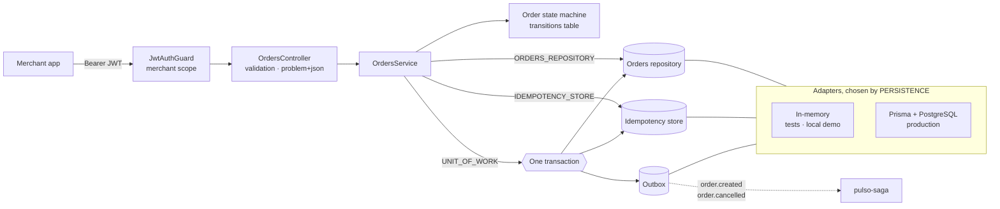
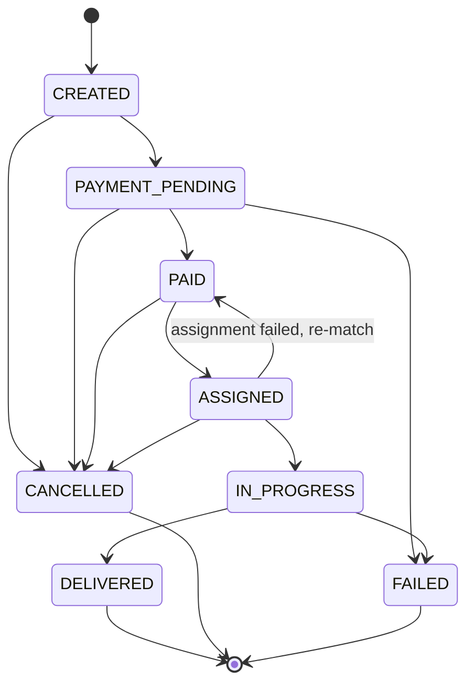

# pulso-orders-api

Orders API for **Pulso**, an on-demand microtask marketplace in LatAm: merchants publish orders
(pick up and deliver, buy something in a store), independent workers ("pulsers") accept and run
them, Pulso charges the merchant and pays the pulser.

This service owns the **order lifecycle**. It is built with NestJS and strict TypeScript and focuses
on the things that make an orders API safe to call from flaky mobile networks and to integrate with
other services: an explicit state machine, idempotent creation, stable cursor pagination, a
consistent error format and domain events published through an outbox.

> Pulso is a fictional company used to explore these patterns.

## Architecture



Order lifecycle (`src/orders/domain/order-state-machine.ts` is the single source of truth):



```
src/
  orders/        domain (Order, state machine, cursor), service, controller, DTOs, adapters
  merchants/     merchant model, API-key hashing, GET /merchants/me
  auth/          POST /auth/token, global JWT guard, scopes
  idempotency/   IdempotencyStore port + adapters
  outbox/        domain events, OutboxService port + adapters
  persistence/   PersistenceModule (DI token swap), UnitOfWork port + adapters, PrismaService
  health/        GET /health
  common/        domain errors, problem+json filter, request-id middleware, validation
prisma/          schema.prisma, committed migrations, seed.sql
test/            e2e suite (supertest against the real app on in-memory adapters)
```

## API

| Method | Path | Scope | Notes |
| --- | --- | --- | --- |
| `POST` | `/auth/token` | public | Exchange a merchant API key for a JWT (`scopes` optional) |
| `GET` | `/merchants/me` | any | The merchant bound to the token |
| `POST` | `/orders` | `orders:write` | Requires `Idempotency-Key`; returns `Location` and `Idempotency-Replayed` |
| `GET` | `/orders?status=&limit=&cursor=` | `orders:read` | Newest first, keyset pagination, `nextCursor` |
| `GET` | `/orders/:id` | `orders:read` | 404 for orders of other merchants |
| `POST` | `/orders/:id/transitions` | `orders:write` | `{ "status": "CANCELLED", "reason": "..." }`; 409 if not allowed |
| `GET` | `/health` | public | 503 when the database is unreachable |
| `GET` | `/docs`, `/docs/openapi.json` | public | Swagger UI and OpenAPI 3 document |

Every error is `application/problem+json` (RFC 9457) and carries the request id:

```json
{
  "type": "https://docs.pulso.example/problems/invalid-transition",
  "title": "Invalid order status transition",
  "status": 409,
  "detail": "Cannot transition order from CREATED to DELIVERED. Allowed: PAYMENT_PENDING, CANCELLED",
  "from": "CREATED",
  "to": "DELIVERED",
  "allowed": ["PAYMENT_PENDING", "CANCELLED"],
  "instance": "/orders/0f8c.../transitions",
  "requestId": "9b1d..."
}
```

Validation failures add an `errors` array with dotted field paths (`items.0.qty`, `pickup.lat`).

## Domain events and the transactional outbox

`order.created` and `order.cancelled` are never sent to a broker from the request path. They are
written to `outbox_events` **in the same database transaction** as the state change that caused
them, through a `UnitOfWork` port:

| Use case | Inside one transaction |
| --- | --- |
| `POST /orders` | insert `orders` row + insert `order.created` outbox row + store the idempotent response |
| `POST /orders/:id/transitions` to `CANCELLED` | `UPDATE orders ... WHERE version = $n` + insert `order.cancelled` outbox row |

The Prisma adapter (`PrismaUnitOfWork`) runs the work in one interactive `prisma.$transaction` and
hands the repositories the transaction client, so either every row commits or none does. The
in-memory adapter (`InMemoryUnitOfWork`) gives the same all-or-nothing guarantee: writes are
staged while the work runs, applied synchronously at commit, and rolled back to a snapshot if any
write fails. The idempotency key is *reserved* outside the transaction (it must be visible to
concurrent retries) and released if the transaction does not commit, so a failed request can be
retried with the same key.

A separate relay process reads unpublished outbox rows, delivers them to the broker and marks them
`published_at`. Delivery is therefore at-least-once; consumers deduplicate on the event `id`.
**These events are consumed by `pulso-saga`**, which orchestrates payment authorization and pulser
assignment and drives the order forward through `POST /orders/:id/transitions`.

## Design decisions and trade-offs

- **Ports and a DI token swap instead of mocking Prisma.** Orders, merchants, idempotency keys and
  the outbox are injected through tokens (`ORDERS_REPOSITORY`, ...). `PersistenceModule.register()`
  binds them to in-memory or Prisma adapters from `PERSISTENCE`. Unit and e2e tests run the real
  service and HTTP pipeline with no database, in about five seconds. The cost is that the Prisma
  adapters are not exercised in CI; they are thin, and were checked manually against PostgreSQL
  (that check is what found the JSONB key-order issue below).
- **Transitions table, not scattered `if`s.** One frozen `Record<OrderStatus, OrderStatus[]>`
  drives validation, the 409 response (which lists the allowed targets) and the tests that
  walk the graph. Cancelling is allowed until a pulser starts the task.
- **Optimistic concurrency.** Each order has a `version`; status updates are a compare-and-set
  (`UPDATE ... WHERE id = $1 AND version = $2`). Two racing transitions cannot both win: the loser
  gets `409 concurrent-modification` instead of silently overwriting.
- **Idempotency keys scoped per merchant.** `reserve` is an atomic insert on
  `(merchant_id, key)`. Same key and same body (hashed in a key-order-independent way) replays
  the stored response byte for byte with `Idempotency-Replayed: true`; same key with a different
  body is a `422`; a retry while the first request is still running is a `409`. If creation fails
  the key is released so the client can retry. Response bodies are stored as `TEXT`, not `JSONB`,
  because JSONB reorders object keys. Keys never expire here; a production deployment would add a
  TTL sweep (24 h is typical).
- **Outbox atomicity over dual writes.** Publishing to a broker after committing (or before) loses
  or invents events when the process dies in between. Writing the event row in the same
  transaction as the state change, and relaying it afterwards, trades a little latency and
  at-least-once delivery for never having an order without its event (or the reverse). This was
  verified against PostgreSQL by making the `outbox_events` insert fail: the request returned 500,
  no order row existed, the key was free, and the retry succeeded.
- **Keyset pagination on `(created_at DESC, id DESC)`** with an opaque base64url cursor. It stays
  stable while new orders arrive and uses the composite indexes in the migration instead of
  `OFFSET`. Tampered cursors are a `400 invalid-cursor`.
- **Tenant isolation by construction.** The merchant id comes only from the verified token `sub`.
  Orders of other merchants are reported as `404`, not `403`, so ids cannot be probed.
- **API keys are stored as SHA-256 hashes** and exchanged for short-lived HS256 tokens with an
  issuer check. Tokens can be narrowed to `orders:read`.
- **Request ids and structured logs.** `X-Request-Id` is propagated when it is safe (it is
  otherwise generated), echoed back, included in every problem document and in one JSON log line
  per request (`ConsoleLogger({ json: true })`).

## Running it

Requires Node 24.

```bash
npm install            # also runs `prisma generate`
cp .env.example .env
```

**Zero-dependency mode** (in-memory adapters, demo merchant seeded):

```bash
PERSISTENCE=memory npm run start:dev
```

**With PostgreSQL via Docker Compose** (migrations and seed run automatically):

```bash
docker compose up --build
```

Then:

```bash
TOKEN=$(curl -s -X POST localhost:3000/auth/token \
  -H 'content-type: application/json' \
  -d '{"apiKey":"pk_demo_pulso_merchant"}' | jq -r .accessToken)

curl -i -X POST localhost:3000/orders \
  -H "authorization: Bearer $TOKEN" \
  -H 'content-type: application/json' \
  -H "idempotency-key: $(uuidgen)" \
  -d '{
    "pickup":  {"lat": 19.4326, "lng": -99.1332, "address": "Farmacia Roma, Álvaro Obregón 120"},
    "dropoff": {"lat": 19.4115, "lng": -99.1694, "address": "Ámsterdam 45, Condesa"},
    "items":   [{"sku": "FARM-PARA-500", "name": "Paracetamol 500 mg", "qty": 2}],
    "amountCents": 18950,
    "currency": "MXN"
  }'
```

Open <http://localhost:3000/docs> for the interactive OpenAPI documentation.

| Variable | Default | |
| --- | --- | --- |
| `PERSISTENCE` | `prisma` | `memory` or `prisma` |
| `DATABASE_URL` | | Required for `prisma` |
| `JWT_SECRET` | | Required, at least 32 characters |
| `JWT_ISSUER` | `pulso-orders-api` | |
| `JWT_TTL_SECONDS` | `3600` | |
| `DEMO_MERCHANT_API_KEY` | `pk_demo_pulso_merchant` | API key of the merchant seeded in memory mode |
| `PORT` | `3000` | |

## Testing

```bash
npm run lint
npm test            # unit + e2e, no database needed
npm run test:unit
npm run test:e2e
npm run test:cov
```

- **Unit** (`src/**/*.spec.ts`): state machine graph, cursor codec, in-memory adapters, auth
  service, problem mapping, the in-memory unit of work (staging, rollback, commit-time version
  check) and `OrdersService` (idempotent replays, key reuse, in-flight keys, events, concurrent
  transitions, pagination, and atomicity: an outbox failure leaves no order and frees the key).
- **E2E** (`test/*.e2e-spec.ts`): the real `AppModule` and HTTP pipeline over supertest: token
  and scope enforcement, forged/expired tokens, request ids, validation errors, idempotency,
  409 invalid transitions, tenant isolation, cursor pagination and the OpenAPI document.

CI (`.github/workflows/ci.yml`) runs lint, typecheck, tests and build, then builds the Docker image
and checks that it runs as a non-root user.

## What this demonstrates

- Modelling a lifecycle as an explicit, tested state machine with meaningful 409s
- Idempotent `POST` semantics (Stripe-style `Idempotency-Key`) including the edge cases
- Hexagonal ports and adapters in NestJS, with DI swapping persistence without touching callers
- Prisma schema design with committed migrations and indexes that match the queries
- Keyset (cursor) pagination, optimistic concurrency and multi-tenant isolation
- JWT bearer auth with scopes and a global guard
- RFC 9457 problem details, request-id correlation and structured logging
- A transactional outbox with an explicit unit-of-work boundary, for a downstream saga
- Fast, database-free unit and e2e tests; multi-stage non-root Docker image; CI

## License

[MIT](LICENSE)
