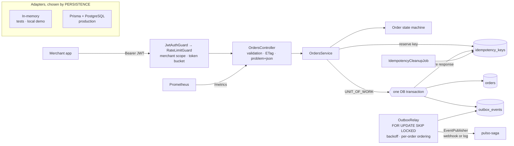
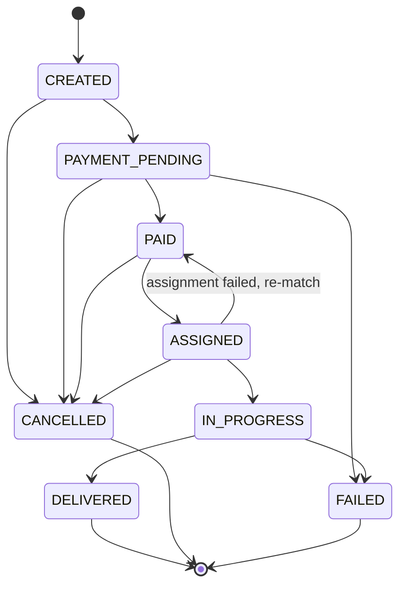

# pulso-orders-api

Orders API for **Pulso**, an on-demand microtask marketplace in LatAm. Merchants publish orders
(pick something up and deliver it, buy something in a store), independent workers ("pulsers")
accept and run them, and Pulso charges the merchant and pays the pulser.

This service owns the **order lifecycle**. It is built with NestJS and strict TypeScript, and it
focuses on what makes an orders API safe to call from flaky mobile networks and safe to integrate
with other services:

- an explicit state machine
- idempotent creation
- optimistic concurrency exposed as ETags
- a transactional outbox with a retrying relay
- versioned event contracts
- rate limiting, metrics and graceful shutdown

> Pulso is a fictional company used to explore these patterns.

## Architecture



Every persistence port (orders, merchants, idempotency keys, unit of work, outbox relay store) is a
DI token. `PersistenceModule.register()` binds the tokens to in-memory or Prisma adapters, so the
entire test suite runs the real services and HTTP pipeline without a database.

Order lifecycle (`src/orders/domain/order-state-machine.ts` is the single source of truth):



```
src/
  orders/        domain (Order, state machine, cursor), service, controller, DTOs, ETags, adapters
  merchants/     merchant model, API-key hashing, GET /merchants/me
  auth/          POST /auth/token, global JWT guard, scopes
  rate-limit/    token bucket and global guard
  idempotency/   IdempotencyStore port + adapters, TTL cleanup job
  outbox/        domain events, wire format, outbox adapters, relay (store port, publishers, backoff)
  persistence/   PersistenceModule (DI token swap), UnitOfWork port + adapters, PrismaService
  metrics/       Prometheus registry, HTTP middleware, /metrics
  health/        liveness, readiness, shutdown drain
  common/        domain errors, problem+json, request ids, validation, clock, PeriodicTask
contracts/       JSON Schemas for published events (shared with pulso-saga)
prisma/          schema.prisma, committed migrations, seed.sql
test/            e2e and contract suites (supertest against the real app on in-memory adapters)
```

## API

| Method | Path | Scope | Notes |
| --- | --- | --- | --- |
| `POST` | `/auth/token` | public | Exchange a merchant API key for a JWT (`scopes` optional) |
| `GET` | `/merchants/me` | any | The merchant bound to the token |
| `POST` | `/orders` | `orders:write` | Requires `Idempotency-Key`; returns `Location`, `ETag`, `Idempotency-Replayed` |
| `GET` | `/orders?status=&limit=&cursor=` | `orders:read` | Newest first, keyset pagination, `nextCursor` |
| `GET` | `/orders/:id` | `orders:read` | `ETag: "v<version>"`; `If-None-Match` → 304; other merchants' orders → 404 |
| `PATCH` | `/orders/:id` | `orders:write` | Edit `dropoff`/`items`/`amountCents` while `CREATED`; `If-Match` required (428/412) |
| `POST` | `/orders/:id/transitions` | `orders:write` | `{ "status": "CANCELLED", "reason": "..." }`; 409 if not allowed; optional `If-Match` |
| `GET` | `/health/live` | public | Liveness: the process is up |
| `GET` | `/health/ready` | public | Readiness: 503 when the database is down or the instance is draining |
| `GET` | `/metrics` | public | Prometheus text format (keep it on the internal network) |
| `GET` | `/docs`, `/docs/openapi.json` | public | Swagger UI and OpenAPI 3 document |

Every error is `application/problem+json` (RFC 9457) and carries the request id:

```json
{
  "type": "https://docs.pulso.example/problems/invalid-transition",
  "title": "Invalid order status transition",
  "status": 409,
  "detail": "Cannot transition order from CREATED to DELIVERED. Allowed: PAYMENT_PENDING, CANCELLED",
  "from": "CREATED",
  "to": "DELIVERED",
  "allowed": ["PAYMENT_PENDING", "CANCELLED"],
  "instance": "/orders/0f8c.../transitions",
  "requestId": "9b1d..."
}
```

Validation failures add an `errors` array with dotted field paths (`items.0.qty`, `pickup.lat`).
`429` responses add `retryAfter` and a `Retry-After` header.

## Domain events: transactional outbox and relay

`order.created` and `order.cancelled` are never sent to a broker from the request path. They are
written to `outbox_events` **in the same database transaction** as the state change that caused
them, through a `UnitOfWork` port:

| Use case | Inside one transaction |
| --- | --- |
| `POST /orders` | insert the `orders` row, insert the `order.created` outbox row, store the idempotent response |
| `POST /orders/:id/transitions` to `CANCELLED` | `UPDATE orders ... WHERE version = $n`, insert the `order.cancelled` outbox row |

- **Prisma adapter.** `PrismaUnitOfWork` runs the work in one interactive `prisma.$transaction`
  and gives the repositories the transaction client.
- **In-memory adapter.** `InMemoryUnitOfWork` gives the same all-or-nothing guarantee. It stages
  writes, applies them synchronously at commit, and restores a snapshot if any write fails.
- **Idempotency key.** The key is *reserved* outside the transaction, because concurrent retries
  must see it. If the transaction does not commit, the key is released.

**The relay** (`OutboxRelay`) is a separate background loop:

- **Claiming.** It claims due, unpublished rows with `SELECT ... FOR UPDATE SKIP LOCKED` inside a
  transaction. Several instances can drain the table without delivering the same row twice. Each
  outcome is recorded before the locks are released.
- **Per-order ordering.** A row is skipped while an earlier row of the same order is still
  undelivered, so `order.cancelled` never overtakes `order.created`. Each tick keeps draining while
  it makes progress, so a chain of events for one order clears quickly.
- **Retries.** Failed deliveries are retried with capped exponential backoff with equal jitter
  (1 s, 2 s, 4 s, … up to 5 min). `attempts`, `next_attempt_at` and `last_error` are stored on
  the row.
- **Delivery.** Delivery goes through an `EventPublisher` port. When `EVENTS_WEBHOOK_URL` is set,
  `HttpEventPublisher` POSTs each event with its id as `Idempotency-Key`. Otherwise
  `LoggingEventPublisher` writes one structured log line per event.

Delivery is therefore **at-least-once**, and consumers deduplicate on the event `id`. **These
events are consumed by `pulso-saga`**, which orchestrates payment authorization and pulser
assignment and drives the order forward through `POST /orders/:id/transitions`.

**Contracts.** The wire format is pinned by JSON Schemas in [`contracts/`](contracts/README.md),
which pulso-saga vendors. `test/contracts.e2e-spec.ts` drives real HTTP flows through the relay
and validates every delivered event against them in Ajv strict mode.

## Design decisions and trade-offs

- **Ports and a DI token swap instead of mocking Prisma.** Unit, e2e and contract tests run in a
  few seconds with no database. The cost is that the Prisma adapters are not exercised in CI. They
  were verified by hand against a PostgreSQL-compatible server (PGlite). That check found that
  JSONB reorders keys, which would have broken byte-identical idempotent replays, so the stored
  response is now `TEXT`. A Testcontainers job is the obvious next step for CI.
- **Outbox over dual writes.** Publishing to a broker before or after committing loses or invents
  events when the process dies in between. Writing the event row in the same transaction costs a
  little latency and gives at-least-once delivery, but an order can never exist without its event
  (or the reverse). This was verified against PostgreSQL by making the `outbox_events` insert fail:
  the request returned 500, no order row existed, the key was free, and the retry succeeded.
- **Relay holds row locks while publishing.** This is simple and correct, but a slow webhook keeps
  a transaction open. Small batches (`OUTBOX_RELAY_BATCH_SIZE`), the publisher timeout (5 s) and
  a 30 s transaction timeout bound the impact. A high-volume deployment would instead claim rows
  with a lease column and publish outside the transaction.
- **Strict per-order ordering.** Holding back later events of an order whose earlier event is
  failing means one stuck order delays only itself, not the whole table.
- **Transitions table, not scattered `if`s.** One frozen `Record<OrderStatus, OrderStatus[]>`
  drives validation, the 409 response (which lists the allowed targets), the tests that walk the
  graph, and a contract test that keeps `order.cancelled.previousStatus` in sync.
- **Optimistic concurrency, visible to clients.** Each order has a `version`, and every write is a
  compare-and-set (`UPDATE ... WHERE id = $1 AND version = $2`). The version is exposed as a strong
  `ETag`. `PATCH` requires `If-Match` (428 without it, 412 when stale), so two dashboards editing
  the same order cannot silently overwrite each other. Without `If-Match`, a lost race on a
  transition is a 409.
- **Idempotency keys, scoped per merchant, with a TTL.**
  - `reserve` is an atomic insert on `(merchant_id, key)`.
  - Same key and same body (hashed independently of key order) replays the stored response byte
    for byte. Same key with a different body is a 422. A retry while the first request is in
    flight is a 409.
  - Keys expire after `IDEMPOTENCY_TTL_SECONDS` (24 h). Expiry also frees reservations stranded by
    a crashed process.
  - A periodic job deletes expired rows, using an index on `created_at`.
- **Rate limiting per instance.** A token bucket per merchant (60 burst, 10/s) runs after
  authentication, plus a per-IP bucket on public routes to slow down API-key guessing. Buckets live
  in process memory, so N replicas allow up to N times the configured rate. That is acceptable as
  abuse protection, but billing-grade quotas would need a shared store such as Redis or the
  gateway.
- **Keyset pagination on `(created_at DESC, id DESC)`** with an opaque base64url cursor. It stays
  stable while new orders arrive and is served by composite indexes instead of `OFFSET`.
- **Tenant isolation by construction.** The merchant id comes only from the verified token `sub`,
  and other merchants' orders are reported as 404.
- **Liveness ignores the database, readiness does not.** A database outage takes replicas out of
  rotation instead of restarting all of them at once.

## Operations

**Graceful shutdown.** On `SIGTERM`, the app:

1. stops the relay and cleanup loops (waiting for the in-flight batch);
2. returns 503 from `/health/ready` for `SHUTDOWN_DRAIN_DELAY_MS` so the load balancer stops
   routing to it;
3. closes the HTTP server, letting in-flight requests finish;
4. closes the Prisma pool.

`SHUTDOWN_TIMEOUT_MS` forces an exit if any step hangs. Compose gives the container 30 s.

**Metrics** (`/metrics`):

| Metric | Type | Labels |
| --- | --- | --- |
| `http_request_duration_seconds` | histogram | `method`, `route` (template, `unmatched` otherwise), `status_code` |
| `orders_by_status` | gauge, computed at scrape | `status` |
| `outbox_pending_events` | gauge, computed at scrape | |
| `orders_created_total`, `idempotent_replays_total` | counter | |
| `order_status_transitions_total` | counter | `from`, `to` |
| `outbox_deliveries_total` | counter | `result` |
| `rate_limited_requests_total` | counter | `scope` |

Node process metrics are also exported. Useful alerts:

- `outbox_pending_events` growing: the relay or its consumer is down.
- A high `rate(outbox_deliveries_total{result="failed"}[5m])`: deliveries keep failing.
- p99 latency per route from the histogram.

**Logs** are JSON lines (`ConsoleLogger({ json: true })`). Each request logs one line with its
`X-Request-Id` (propagated when it is safe, otherwise generated), and the same id appears in
every problem document.

## Running it

Requires Node 24.

```bash
npm install            # also runs `prisma generate`
cp .env.example .env
```

**Zero-dependency mode** (in-memory adapters, demo merchant seeded):

```bash
PERSISTENCE=memory npm run start:dev
```

**With PostgreSQL via Docker Compose** (migrations and seed run automatically):

```bash
docker compose up --build
```

Then:

```bash
TOKEN=$(curl -s -X POST localhost:3000/auth/token \
  -H 'content-type: application/json' \
  -d '{"apiKey":"pk_demo_pulso_merchant"}' | jq -r .accessToken)

curl -i -X POST localhost:3000/orders \
  -H "authorization: Bearer $TOKEN" \
  -H 'content-type: application/json' \
  -H "idempotency-key: $(uuidgen)" \
  -d '{
    "pickup":  {"lat": 19.4326, "lng": -99.1332, "address": "Farmacia Roma, Álvaro Obregón 120"},
    "dropoff": {"lat": 19.4115, "lng": -99.1694, "address": "Ámsterdam 45, Condesa"},
    "items":   [{"sku": "FARM-PARA-500", "name": "Paracetamol 500 mg", "qty": 2}],
    "amountCents": 18950,
    "currency": "MXN"
  }'

# Correct the drop-off before payment, using the ETag from the response above
curl -i -X PATCH localhost:3000/orders/<id> \
  -H "authorization: Bearer $TOKEN" -H 'content-type: application/json' \
  -H 'if-match: "v0"' \
  -d '{"dropoff": {"lat": 19.3467, "lng": -99.1617, "address": "Francisco Sosa 30, Coyoacán"}}'
```

Open <http://localhost:3000/docs> for the interactive OpenAPI documentation.

| Variable | Default | |
| --- | --- | --- |
| `PERSISTENCE` | `prisma` | `memory` or `prisma` |
| `DATABASE_URL` | | Required for `prisma` |
| `JWT_SECRET` | | Required, at least 32 characters |
| `JWT_ISSUER` / `JWT_TTL_SECONDS` | `pulso-orders-api` / `3600` | |
| `DEMO_MERCHANT_API_KEY` | `pk_demo_pulso_merchant` | API key of the merchant seeded in memory mode |
| `PORT` | `3000` | |
| `OUTBOX_RELAY_ENABLED` | `true` | Run the relay loop in this process |
| `OUTBOX_RELAY_INTERVAL_MS` / `OUTBOX_RELAY_BATCH_SIZE` | `1000` / `50` | |
| `OUTBOX_RELAY_RETRY_BASE_MS` / `OUTBOX_RELAY_RETRY_MAX_MS` | `1000` / `300000` | Backoff bounds |
| `EVENTS_WEBHOOK_URL` | | POST events here; unset logs them instead |
| `IDEMPOTENCY_TTL_SECONDS` | `86400` | Replay window for `Idempotency-Key` |
| `IDEMPOTENCY_CLEANUP_ENABLED` / `IDEMPOTENCY_CLEANUP_INTERVAL_MS` | `true` / `3600000` | |
| `RATE_LIMIT_ENABLED` | `true` | |
| `RATE_LIMIT_CAPACITY` / `RATE_LIMIT_REFILL_PER_SECOND` | `60` / `10` | Per merchant |
| `RATE_LIMIT_ANON_CAPACITY` / `RATE_LIMIT_ANON_REFILL_PER_SECOND` | `10` / `1` | Per IP, public routes |
| `TRUST_PROXY` | `false` | Set behind a load balancer so `req.ip` is the client |
| `SHUTDOWN_DRAIN_DELAY_MS` / `SHUTDOWN_TIMEOUT_MS` | `5000` / `25000` | |

## Testing

```bash
npm run lint
npm test            # unit + e2e + contracts, no database needed
npm run test:unit
npm run test:e2e
npm run test:cov
```

182 tests: 110 unit and 72 e2e/contract.

- **Unit** (`src/**/*.spec.ts`):
  - state machine graph, cursor codec, ETag parsing, token bucket, backoff, `PeriodicTask`
  - in-memory adapters and unit of work: staging, rollback, commit-time version checks
  - outbox relay: ordering, retries with backoff, concurrent drains, batch size
  - webhook publisher, cleanup job and problem mapping
  - `OrdersService`:
    - idempotent replays, key reuse, in-flight keys and TTL expiry
    - atomicity: an outbox failure leaves no order and frees the key
    - conditional updates and concurrent transitions
    - pagination
- **E2E** (`test/*.e2e-spec.ts`): the real `AppModule` and HTTP pipeline over supertest:
  - auth and scopes, forged and expired tokens, request ids, validation
  - idempotency, invalid transitions, tenant isolation, pagination
  - ETag, If-Match and If-None-Match
  - 429 and Retry-After
  - `/metrics`
  - readiness while draining
  - relay delivery after commit
- **Contracts** (`test/contracts.e2e-spec.ts`): delivered events against `contracts/` schemas,
  plus negative cases that would break consumers.

CI (`.github/workflows/ci.yml`) runs a production dependency audit, lint, typecheck, tests and
build, then builds the Docker image and checks that it runs as a non-root user. See
[SECURITY.md](SECURITY.md) for the dependency policy and known advisories.

## What this demonstrates

- Modelling a lifecycle as an explicit, tested state machine with meaningful 409s
- Idempotent `POST` semantics (Stripe-style `Idempotency-Key`) including TTL and edge cases
- A transactional outbox with an explicit unit-of-work boundary, and a relay using
  `SKIP LOCKED`, per-aggregate ordering and backoff
- Consumer-facing event contracts as JSON Schema, enforced by producer tests
- Optimistic concurrency end to end: version column, compare-and-set, `ETag`/`If-Match`
- Hexagonal ports and adapters in NestJS, with DI swapping persistence without touching callers
- Prisma schema design with committed migrations and indexes that match the queries
- JWT bearer auth with scopes, per-merchant token-bucket rate limiting
- Operability: RFC 9457 errors, request-id correlation, structured logs, Prometheus metrics,
  liveness and readiness probes, and graceful shutdown with a drain phase
- Fast, database-free unit/e2e/contract tests; multi-stage non-root Docker image; CI with audit
  gate

## License

[MIT](LICENSE)
